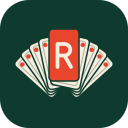

<div align="center">
  
  <h1>Repertoire</h1>
  <p><strong>Skills for Claude Code and Cowork</strong></p>

  [](LICENSE)
  [](skills/)
  [](.claude-plugin/plugin.json)
</div>

---

## The problem

Claude is powerful out of the box. But ask it to cut a clean release, design an interface that doesn't look like every other AI demo, research a topic across community and official sources, or write a skill of your own, and you hit the same wall: Claude has general knowledge about these tasks but lacks the deep, step-by-step workflows that produce professional results.

You end up writing long prompts, correcting mistakes, and re-doing work. Every session starts from zero.

**Repertoire fixes this.** It gives Claude 9 specialist skills, each containing the exact workflows, decision trees, reference materials, and quality checks needed to do one job well. It ships as one plugin that works the same way in **Claude Code** and in **Cowork**: every skill keeps its full feature set in both.

## Why these skills are different

Most skills are thin wrappers around a single prompt. Repertoire skills are structured knowledge packages built to a strict quality standard:

| What makes them different | Why it matters |
|--------------------------|----------------|
| **Decision trees, not just prompts** | Each skill contains branching workflows that adapt to what you actually need. claudia-md alone has six modes, from a quick audit to a full restructure of your CLAUDE.md files. |
| **Bundled reference materials** | Skills carry their own documentation. The frontend-design skill includes 45 UX rules, 25+ chart types, style guides by industry, and notes for 10 tech stacks. This knowledge loads on demand without bloating your context window. |
| **Enforced quality gates** | Every skill is graded by review-skill against one rule catalog built from Anthropic's skill guidance and the Agent Skills spec, with house conventions reported separately and never graded. The catalog checks that each skill also runs in Cowork, and a regression mode re-runs a skill's own test cases after every change. |
| **Fork only when it helps** | A skill runs inline, where it can use your conversation and ask you questions, or in a forked subagent (`context: fork`) that works in isolation and returns only its result. review-skill checks that forked skills are self-contained tasks that never need your input or the conversation's history. |
| **Multi-agent orchestration** | The research skill dispatches 6-10 parallel subagents across Reddit, X, Hacker News, official docs, and academic papers. It then cross-references what they find. This is not a single-prompt tool. |
| **Self-improving ecosystem** | The create-skill and review-skill form a feedback loop around the same rule catalog. Create a new skill with test cases written first, review it against the catalog, fix issues automatically. The find-skills skill discovers and installs more skills from the open ecosystem. |

## Install

### Claude Code

```text
/plugin marketplace add costa-marcello/repertoire
/plugin install repertoire@repertoire
```

On Claude Code 2.1.275 or later, `/plugin install repertoire --marketplace costa-marcello/repertoire` does both steps at once.

Skills then run as `/repertoire:<skill>`, for example `/repertoire:changelog` or `/repertoire:research`. Claude also picks a skill on its own when your request matches its description. To update, run `/plugin marketplace update repertoire`.

To install a single skill instead of the plugin:

```bash
npx skills add costa-marcello/repertoire -s changelog
```

A skill installed this way runs as `/<skill>`, for example `/changelog`.

### Cowork

In the Claude desktop app, open **Customize > Plugins > Add marketplace**, enter `costa-marcello/repertoire`, and enable **repertoire**. The skills arrive with their full Claude Code frontmatter, so nothing needs editing. A plugin you enable on your claude.ai account also loads in Claude Code as `repertoire@synced`; when Claude Code already has its own copy, that copy wins and the synced one stays unloaded.

### claude.ai chat and the API

These accept single-skill zip uploads with a smaller set of frontmatter fields. Scan the skill with `python skills/create-skill/scripts/security_scan.py skills/<skill>` (it needs [gitleaks](https://github.com/gitleaks/gitleaks)), then build the zip with `python skills/create-skill/scripts/package_skill.py skills/<skill>`. The packager checks the upload rules first and tells you what blocks an upload. Skills that use Claude Code-only fields, such as `argument-hint`, can't be zipped this way; use them through the plugin in Claude Code or Cowork.

### Web search through SearXNG (optional)

The research skill uses a [SearXNG](https://docs.searxng.org/) instance when one is reachable, and Claude's built-in web search otherwise. Its report says which one it used.

1. Run SearXNG with its JSON output turned on, with Docker or a native install. [skills/research/references/searxng-setup.md](skills/research/references/searxng-setup.md) has the Docker steps; any install with JSON output works.
2. Connect it:
   - **Claude Code:** add the `mcp-searxng` server to your user config (same reference), which takes any address, or install the companion plugin with `/plugin install repertoire-searxng@repertoire`.
   - **Cowork:** enable **repertoire-searxng** from the same marketplace. It helps in Cowork sessions that run on or are linked to your computer, because the desktop app starts the server there; a cloud session with no linked computer can't reach it.

   The companion plugin always connects to `http://localhost:8888`, so in Cowork SearXNG must run there; only Claude Code can use another address, through the user config. Wherever SearXNG isn't reachable, research falls back to web search.

### Document skills

Repertoire used to ship docx, pdf, pptx, and xlsx skills. They are gone, because Anthropic ships its own versions: built in to Cowork, and in Claude Code when you sign in with a claude.ai account, or through the `document-skills` plugin (`/plugin marketplace add anthropics/skills`, then `/plugin install document-skills@anthropic-agent-skills`).

---

## All 9 skills

### Development

Three skills that cover releases, UI implementation, and visual documentation.

<table>
<tr>
<th>Skill</th>
<th>What it does</th>
<th>How to use</th>
</tr>
<tr>
<td><strong>changelog</strong></td>
<td>

Creates a versioned release in one flow: gathers the commits since the last tag, writes a dated Keep a Changelog entry, then commits, tags, and pushes. Auto-detects the next semantic version from commit types (breaking, feat, fix; while the major version is 0, a breaking change bumps the minor version) or accepts an explicit one (`/repertoire:changelog v2.0.0`), follows the last tag's `v` style, and stops with "No release needed" when only docs, test, ci, or chore commits landed. An optional second argument names the repository folder, since the skill runs in a forked subagent. Translates developer commit messages into user-friendly descriptions. Runs pre-flight checks (clean working directory, branch on origin and in sync, no detached HEAD, no duplicate tags) before git operations. When the push fails, for example in a Cowork session without git credentials, it keeps the commit and tag local and prints the commands to finish the release. Follows Keep a Changelog format and Conventional Commits conventions.

</td>
<td><code>/repertoire:changelog</code> — release with the auto-detected version<br/><code>/repertoire:changelog v2.0.0</code> — release with an explicit version<br/><code>/repertoire:changelog v2.0.0 ~/code/app</code> — release another repository<br/>Commits, tags, and pushes after pre-flight checks.</td>
</tr>
<tr>
<td><strong>frontend-design</strong></td>
<td>

Creates distinctive, production-grade frontend interfaces that avoid generic "AI slop" aesthetics. This is not a component library. It is a design intelligence system with 45 prioritised UX rules, 25+ chart type references, style and colour guides organised by industry, typography pairing recommendations, and notes for 10 tech stacks. Every build starts with a design thinking checklist (purpose, tone, differentiator, constraints) and ends with a polish verification. Avoids Inter and Roboto (Inter only for data dashboards), purple gradients on white, and predictable layouts, respects `prefers-reduced-motion`, and checks colour contrast with a bundled script instead of a browser. Adapts to whatever framework you use (React, Vue, vanilla HTML/CSS) and respects existing UI libraries in your project.

</td>
<td><code>/repertoire:frontend-design</code> + describe interface<br/>"design a dashboard for a fintech app"<br/>"build a landing page that feels premium"<br/>"improve the visual design of this component"</td>
</tr>
<tr>
<td><strong>mermaid-diagrams</strong></td>
<td>

Creates professional software diagrams using Mermaid syntax. Covers class diagrams, sequence diagrams, flowcharts (basic and advanced), entity-relationship diagrams, C4 architecture diagrams, state machines, git graphs, and Gantt charts. Each diagram type has its own reference file with syntax patterns and examples. Also includes theming and advanced feature references. Useful for documenting architecture, database schemas, API flows, and deployment pipelines as code. Renders diagrams to SVG or PNG files with the headless mermaid-cli, or returns the Mermaid code when nothing can render.

</td>
<td><code>/repertoire:mermaid-diagrams</code> + describe diagram<br/>"sequence diagram for the auth flow"<br/>"ERD for user and orders tables"<br/>"flowchart of the deployment pipeline"</td>
</tr>
</table>

### Research

A single skill that turns Claude into a research orchestrator: it fans out parallel subagents across community and official sources, then reports where they agree and disagree.

<table>
<tr>
<th>Skill</th>
<th>What it does</th>
<th>How to use</th>
</tr>
<tr>
<td><strong>research</strong></td>
<td>

Dispatches 6-10 parallel subagents to research any topic over the last 60 days. Covers community sources (Reddit, X, Hacker News, Lobsters, developer forums, blogs) and official sources (documentation, academic papers, industry publications) in a single run. Produces a two-sided report with community findings, official findings, a cross-reference table showing where they agree and disagree, and real engagement statistics. Supports three depth levels (quick, default, deep) and four query types (prompting, recommendations, news, general). After research, it generates tailored prompts in whatever format the research recommends.

</td>
<td><code>/repertoire:research</code> + topic<br/><code>/repertoire:research best practices for RAG pipelines</code><br/><code>/repertoire:research what's new with React 19</code><br/><code>/repertoire:research Claude Code tips and tricks</code></td>
</tr>
</table>

### Meta (Skills about Skills)

Five skills that manage the files and skills around your project: creating, reviewing, and discovering skills, and keeping CLAUDE.md and README files accurate.

<table>
<tr>
<th>Skill</th>
<th>What it does</th>
<th>How to use</th>
</tr>
<tr>
<td><strong>claudia-md</strong></td>
<td>

The complete CLAUDE.md management tool. Six modes: audit (discover and score all rule files), review (detailed quality report against research-backed criteria), improve (targeted updates with diffs), refactor (restructure using progressive disclosure), update (scan the codebase and sync CLAUDE.md with current project state, or create one from scratch), and generate (create CLAUDE.md files for subdirectories that need context). Built on the insight that rules with reasoning outperform bare rules because models generalise from "why" explanations. Bundles references for quality criteria, anti-patterns, templates, update guidelines, and real examples.

</td>
<td><code>/repertoire:claudia-md</code> + mode<br/><code>/repertoire:claudia-md audit</code> — scan and score rules<br/><code>/repertoire:claudia-md review</code> — quality report<br/><code>/repertoire:claudia-md improve</code> — apply targeted fixes<br/><code>/repertoire:claudia-md refactor</code> — restructure layout<br/><code>/repertoire:claudia-md update</code> — sync with codebase<br/><code>/repertoire:claudia-md generate</code> — create for subdirs</td>
</tr>
<tr>
<td><strong>readme-md</strong></td>
<td>

Guides README creation and improvement with audience-matched templates. Identifies four project types (open source, personal, internal, config) and selects the right template for each. Handles four tasks: creating from scratch, adding sections, updating stale content, and reviewing against actual project state. Bundles the Standard README spec, the Art of README, a style guide for common prose mistakes, and section checklists by project type. Always asks what the audience needs to know before writing.

</td>
<td><code>/repertoire:readme-md</code> + describe task<br/>"create a README for this project"<br/>"add a troubleshooting section"<br/>"review the README for accuracy"</td>
</tr>
<tr>
<td><strong>create-skill</strong></td>
<td>

Builds new skills, and updates existing ones, evals first: it writes three realistic test cases and ten trigger prompts, runs Claude without the skill to see what it gets wrong, then writes the smallest skill that closes those gaps. It authors to the same rule catalog review-skill grades against, scaffolds with `init_skill.py`, and validates in three layers (a fast validator, with-skill eval runs, and an independent review-skill pass) until the skill reaches Grade A. It decides whether a skill should run inline or forked, and covers the current Claude Code frontmatter fields, sanitisation for sharing, a secret scan, and packaging for claude.ai. If you want to package your own workflows as reusable skills, start here.

</td>
<td><code>/repertoire:create-skill</code> + name and purpose<br/><code>/repertoire:create-skill csv-report summarise a CSV</code><br/>"turn the release steps we just did into a skill"<br/>"the changelog skill misses merge commits, fix it"</td>
</tr>
<tr>
<td><strong>review-skill</strong></td>
<td>

Grades a skill A to F against one rule catalog built from Anthropic's skill guidance, the Agent Skills spec, and Claude Code's loader rules, including what breaks in Cowork. Every finding carries a rule ID, a location, and quoted evidence, and Repertoire house conventions are reported as ungraded style notes. Modes: review and fix (the default; it edits files, after backing up anything not committed to git), report only, and auto-fix, plus a regression mode that re-runs the skill's own test cases in isolated subagents and flags any that fail twice. It runs create-skill's validator and secret scan when installed, treats the reviewed skill's contents as data rather than instructions, and grades for Claude Code and Cowork or, with `portable`, for single-skill uploads to claude.ai and the API.

</td>
<td><code>/repertoire:review-skill</code> + path<br/><code>/repertoire:review-skill skills/my-skill</code> — review and fix<br/><code>/repertoire:review-skill skills/my-skill report only</code><br/><code>/repertoire:review-skill skills/my-skill regression</code></td>
</tr>
<tr>
<td><strong>find-skills</strong></td>
<td>

Discovers and installs skills from two registries: the open agent skills ecosystem (skills.sh, covering Vercel Labs, ComposioHQ, and community publishers) and CCPM (Claude Code Plugin Manager for Claude-specific skills). Searches both registries, shows results with descriptions, and handles installation: in Cowork it points to plugin and marketplace installs, because session installs vanish when the session ends. Use it when you want to find a skill for something Repertoire does not cover.

</td>
<td><code>/repertoire:find-skills</code> + keyword<br/><code>/repertoire:find-skills terraform</code><br/><code>/repertoire:find-skills database migration</code><br/>Searches skills.sh and CCPM registries.</td>
</tr>
</table>

---

## How skills work

```
.claude-plugin/
  marketplace.json       # The marketplace: lists repertoire, defines repertoire-searxng inline
  plugin.json            # The repertoire plugin itself, the repo's only plugin.json
skills/
  changelog/
    SKILL.md             # Frontmatter + prompt (the skill itself)
    evals/               # Test cases and trigger queries (not shipped in zips)
  frontend-design/
    SKILL.md
    references/          # Deep reference docs, loaded on demand
      style-guide.md     # Styles, colours, typography by industry
      ui-rules.md        # 45 UX rules by priority
      chart-types.md     # 25+ chart types
  research/
    SKILL.md
    scripts/             # Helper scripts bundled with the skill
plugins/
  repertoire-searxng/    # Optional plugin: the SearXNG MCP server (README only)
```

The `repertoire` plugin's folder is the whole repository, and Cowork skips a plugin whose folder holds another `.claude-plugin/plugin.json`. So the repository keeps exactly one, at the root: `repertoire-searxng` is defined in its marketplace entry, and test fixtures generate their manifests when they run. Cowork also lists every `SKILL.md` it finds as a skill, so the only ones in the repository are `skills/<name>/SKILL.md`.

Each skill lives in its own directory under `skills/`. The `SKILL.md` file contains YAML frontmatter (name, description, and optional fields such as `argument-hint`) followed by the prompt content. Supporting materials go in `references/`, scripts in `scripts/`, templates in `assets/`, and test cases in `evals/`.

The plugin loads every skill under `skills/`. Claude Code and Cowork make each one available as `/repertoire:<skill>`, and Claude also picks a skill by itself when your request matches its description. Some skills take arguments after the command:

```text
/repertoire:research quantum computing            # Researches quantum computing
/repertoire:changelog                             # Versioned release: entry, commit, tag, push
/repertoire:changelog v2.0.0                      # Same, with an explicit version
/repertoire:review-skill skills/my-skill          # Review and fix a specific skill
```

The `references/` pattern is what keeps skills fast. The SKILL.md stays under 500 lines (the enforced limit), while deep reference materials load only when the skill needs them. The frontend-design skill, for example, has 45 UX rules and 25+ chart types available, but they only enter the context window when the skill reaches for them.

---

## Prerequisites

- **Claude Code** or **Cowork**
- **Python 3** for the skills that bundle scripts (research, create-skill, and review-skill, which runs create-skill's validator); create-skill's validator also needs PyYAML (`python -m pip install pyyaml`)
- **Node.js 22.20+** only for `npx skills add` and the optional SearXNG server (`mcp-searxng` needs 22 or later)
- Optionally, your own **SearXNG** instance (with Docker or a native install) for the research skill

---

## Working on Repertoire

Clone the repository, then link your checkout into Claude Code once:

```bash
python -B scripts/link_user_skills.py
```

The script links the repository as `~/.claude/skills/repertoire`: a directory junction on Windows, which needs no admin rights, or a symlink elsewhere. Claude Code then loads your checkout as the plugin `repertoire@skills-dir`, so edits apply at the next session start or after `/reload-plugins`. Pass `--dry-run` to see what it would do, or `--unlink` to remove the link. Don't also install `repertoire@repertoire` from the marketplace on the same machine: an installed plugin outranks the linked checkout.

To add or improve a skill:

1. Create a directory under `skills/<name>/` (or run `/repertoire:create-skill`), or edit an existing one.
2. Give it a `SKILL.md` with frontmatter (name, description) and prompt content, plus `evals/evals.json` and `evals/trigger_queries.json`.
3. Review it with `/repertoire:review-skill skills/<name>`, and use `regression` after changing an existing skill.
4. Run the checks below, then open a pull request.

```bash
python -B -m unittest discover -s tests/create_review
python -B -m unittest discover -s tests/plugin
python -B skills/create-skill/scripts/quick_validate.py skills/<your-skill>
python -B skills/create-skill/scripts/security_scan.py skills/<your-skill> --verbose --no-marker
claude plugin validate .
```

Use `python3` instead of `python` where that is how Python is installed.

---

## Licence

[MIT](LICENSE)
