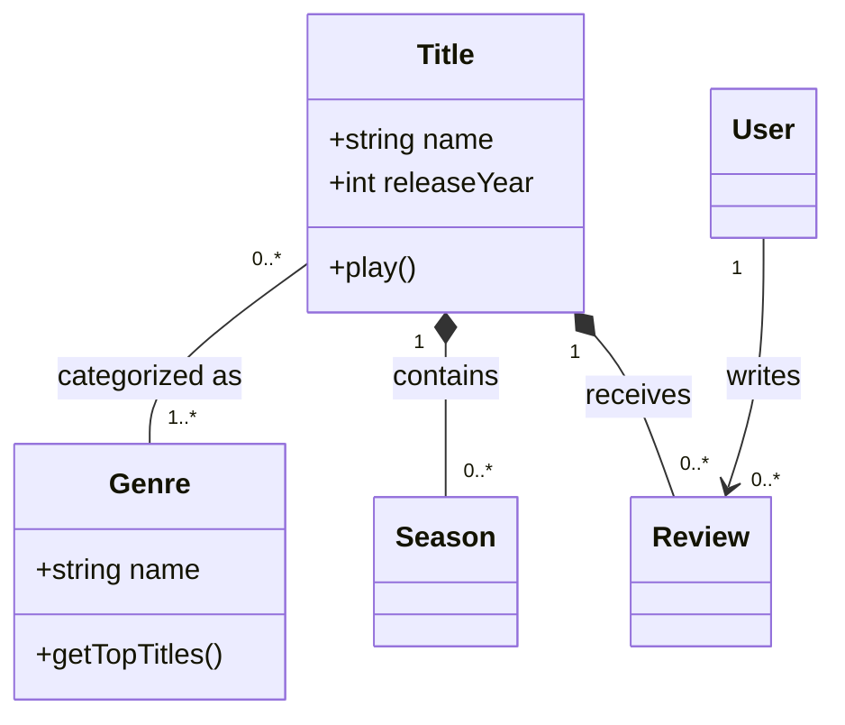
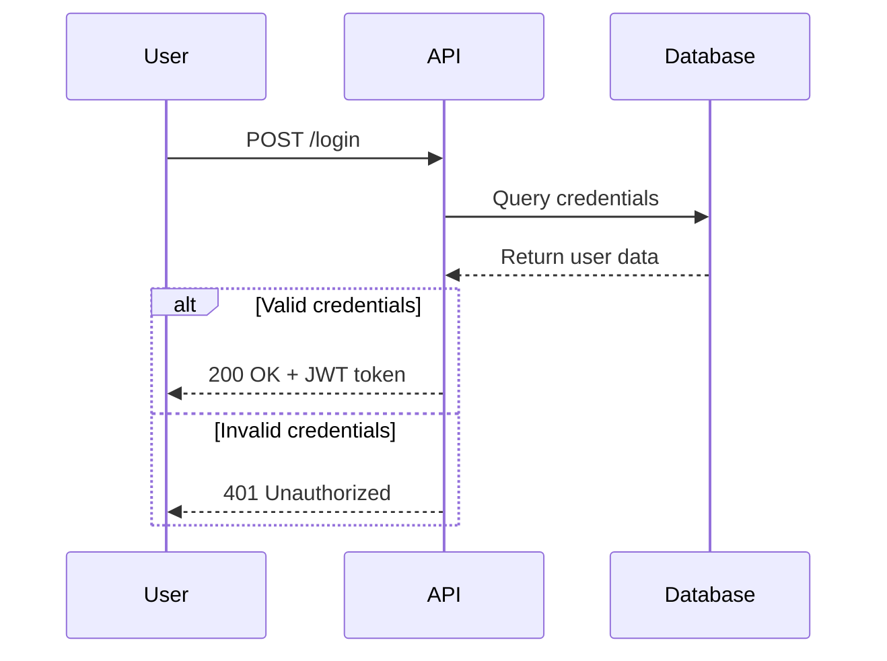
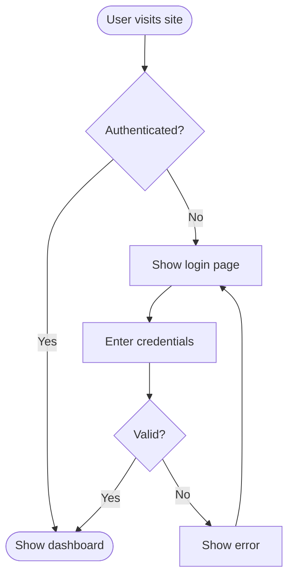
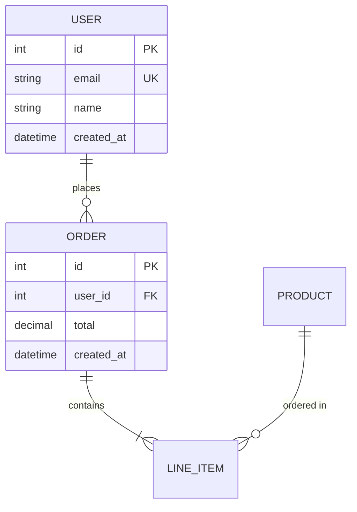
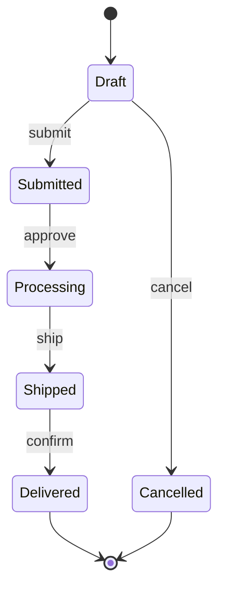
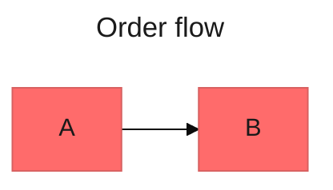

# Mermaid Diagrams

Writes Mermaid diagrams that parse on the first try, and renders them to files without a display.

<instructions>

## Workflow

1. **Pick the type** from the table below. Default to a flowchart when the intent is unclear, because it covers the widest range of requests.
2. **Read the reference** for that type before writing anything beyond what the examples below show.
3. **Write** the diagram by the Step 1 syntax rules.
4. **Self-check** it (Step 2). Fix every problem yourself; never ask the user to fix syntax.
5. **Render** it to a file when Step 3 says to.
6. **Repair** any render error (Step 4) and render again.

| Type (keyword) | Use for | Read |
|----------------|---------|------|
| Flowchart (`flowchart`) | Processes, algorithms, decision trees, user journeys | `references/flowcharts-basic.md`; styling and long examples in `references/flowcharts-advanced.md` |
| Sequence (`sequenceDiagram`) | API calls, auth flows, messages between components | `references/sequence-diagrams.md` |
| Class (`classDiagram`) | Domain models, object-oriented design | `references/class-diagrams.md` |
| ER (`erDiagram`) | Database schemas, table relationships | `references/erd-basic.md`; full schemas and patterns in `references/erd-patterns.md` |
| C4 (`C4Context`, `C4Container`, `C4Component`) | Architecture at the context, container, and component levels | `references/c4-diagrams.md` |
| State (`stateDiagram-v2`) | Lifecycles, state machines | `references/other-diagrams.md` |
| Git graph (`gitGraph`) | Branching strategies, release flow | `references/other-diagrams.md` |
| Gantt (`gantt`) | Timelines, sprint plans | `references/other-diagrams.md` |
| Pie (`pie`), quadrant (`quadrantChart`) | A few proportions, 2x2 prioritization | `references/other-diagrams.md` |

For themes, colors, and node styling, read `references/theming.md`. For layout engines, click links, mermaid-cli flags, and embedding in HTML or React, read `references/advanced-features.md`.

Mermaid also has mindmap, timeline, user journey, sankey, XY chart, block, and architecture diagrams. Some still take a `-beta` keyword, and older renderers lack the newer ones, so verify the keyword against the Mermaid docs (mermaid.js.org) before using one.

### Step 1: Write by these syntax rules

| Rule | Wrong | Right | Why |
|------|-------|-------|-----|
| Quote labels that contain brackets or parentheses | `A[Retry (max 3)]` | `A["Retry (max 3)"]` | An inner `(`, `[`, or `{` ends the shape early |
| Quote labels that contain `%`, `&`, `<`, `>`, `#`, or `;` | `A[Load: 50% & rising]` | `A["Load: 50% & rising"]` | These characters start comments, node chains, HTML, entity codes, or new lines. Plain words with `?`, `:`, `'`, `+`, or a single `-` need no quotes, and quoting any label is safe |
| Write a double quote inside a label as `#quot;` | `A["Say "hi""]` | `A["Say #quot;hi#quot;"]` | A bare `"` ends the quoted label |
| Never name a node lowercase `end` | `D --> end` | `D --> End["end"]` | `end` closes subgraphs and blocks |
| Keep `{}` out of `%%` comments | `%% config: {dark}` | `%% config: dark theme` | `%%{ }%%` is directive syntax |
| Space out links before IDs that start with `o` or `x` | `dev---ops` | `dev --- ops` | `---o` and `---x` draw circle and cross edges |
| Write a semicolon in a sequence message as `#59;` | `A->>B: save; notify` | `A->>B: save#59; notify` | `;` ends the line in sequence diagrams |
| Give each distinct node its own ID | `A` reused in two subgraphs | `A1`, `A2` | A reused ID is the same node, silently moved |
| Put config frontmatter first | Any line above `---` | `---` alone on line 1 | Mermaid reads frontmatter only from the first line |

### Step 2: Self-check

Check the diagram before output:

1. The first line after any frontmatter is the type keyword with its exact case (`classDiagram`, not `classdiagram`).
2. Every label passes the Step 1 table.
3. The arrows match the type: `-->` in flowcharts and state diagrams, `->>` and `-->>` in sequence diagrams, `<|--`, `*--`, `o--`, `..>` in class diagrams, `||--o{` and similar in ER diagrams.
4. Every `subgraph`, `alt`, `opt`, `loop`, `par`, `critical`, `break`, `rect`, and `box` block closes with its own `end`.
5. Sequence participants whose names have spaces or punctuation get a short ID and an alias: `participant Auth as Authorization server`. Avoid `as`, `end`, and other keywords as IDs.
6. The diagram has about 15 nodes or fewer. Split a bigger one into focused views linked from an overview, unless the user wants one large diagram (then see Layout under Configuration).

Most mistakes make the whole diagram fail with "Syntax error". Some fail silently instead: a reused ID merges two nodes, and a misspelled config key is ignored.

### Step 3: Render to a file

Rendering needs no display: mermaid-cli (`mmdc`) draws the diagram in a headless browser and writes a file.

**When to render:** when the user asks for an image (SVG, PNG, or PDF) or asks to check that a diagram renders. When you only write a `.mmd` or Markdown file and `mmdc` is already installed, render it to a temporary folder as a check. Otherwise the Step 2 self-check is the check, and the code is the output.

1. Save the diagram as a `.mmd` file named after its subject, such as `checkout-flow.mmd`: in Cowork, in the outputs folder; in a repository, next to the code it describes; for a check only, in a temporary folder. If a file of that name exists and is not the diagram you are updating, pick a new name instead of overwriting it.
2. Run `mmdc -i checkout-flow.mmd -o checkout-flow.svg`. Use `.png` for slides and chat (add `-s 2` for a sharper image) and `.pdf` for print.
3. Without `mmdc`, run `npx -y -p @mermaid-js/mermaid-cli mmdc -i checkout-flow.mmd -o checkout-flow.svg`. The first run downloads mermaid-cli from npm and a headless Chrome build for it (network; the browser is a large download). The render itself runs locally and uploads nothing.
4. If Chrome fails to launch (often "No usable sandbox" when running as root, as in a container), add `-p ${CLAUDE_SKILL_DIR}/assets/puppeteer-config.json`, which turns off the browser sandbox for this local render. Add it only after that failure.
5. If the command prints an error, take the message to Step 4. To check the layout, render a PNG too and read it as an image.
6. When neither command can run (no Node.js or no network), output the code, say that it was not rendered here and why, and give the `npx` command from item 3 to run elsewhere. The code also renders on GitHub, on GitLab, and in VS Code with a Mermaid extension. Offer [mermaid.live](https://mermaid.live) only as a last resort, for a user with a browser who wants an image file.

### Step 4: Repair

1. Read the error message. A parse error names the failing line.
2. Match that line against the Step 1 table and Step 2 list, and fix it.
3. Render again if Step 3 ran, and output the fixed diagram, naming each fix in one line.
4. Never output the same broken syntax twice.

If `mmdc` renders a diagram that fails on the user's platform, the platform probably runs an older Mermaid: see Platform support below.

</instructions>

<example>

### Class diagram (domain model)

</example>

<example>

### Sequence diagram (API flow)

</example>

<example>

### Flowchart (user journey)

</example>

<example>

### ER diagram (database schema)

</example>

<example>

### State diagram (order lifecycle)

</example>

<configuration>

## Configuration

Configure a diagram in frontmatter at the top of the code:

**Theme:** default to `default`.

| Theme | When to use |
|-------|-------------|
| `default` | General-purpose diagrams |
| `neutral` | Grayscale documentation and print |
| `dark` | Dark-mode pages or slides |
| `forest` | Green tones, when the page calls for them |
| `base` | Custom colors through `themeVariables` |

`themeVariables` take effect only with `theme: base`, and only hex colors work (`#ff6b6b`, not `red`).

**Layout:** leave `layout` unset to get the renderer's default. When one large diagram has badly crossed edges, set `layout: elk`.

**Look:** default to `classic`. Use `handDrawn` for informal docs and whiteboard-style slides.

Which themes, layouts, and looks exist depends on the Mermaid version, and newer releases add more. Verify against the Mermaid docs before relying on anything beyond the defaults above.

## Platform support

Each platform bundles its own Mermaid version, so syntax that `mmdc` renders (`look`, `layout: elk`, newer node shapes and diagram types) can still fail there. Treat this table as a starting point and verify against the platform's docs when it matters.

| Platform | How it renders Mermaid |
|----------|------------------------|
| GitHub | Code fences tagged `mermaid` in Markdown files, issues, and pull requests. C4 is experimental in Mermaid and often fails. |
| GitLab | Code fences tagged `mermaid` |
| VS Code | Markdown preview, once a Mermaid extension is installed |
| Azure DevOps wiki | `::: mermaid` blocks closed by `:::`, not backtick fences |
| Markdown-to-PDF tools | Often print the code. Render an SVG or PNG (Step 3) and embed the image. |

With Docker and no Node.js, the mermaid-cli image does the Step 3 render: `docker run --rm -u "$(id -u):$(id -g)" -v "$(pwd)":/data minlag/mermaid-cli -i checkout-flow.mmd -o checkout-flow.svg`. In PowerShell, mount with `-v "${PWD}:/data"` and drop `-u`. The first run pulls the image from Docker Hub (network).

</configuration>

<best-practices>

## Best Practices

1. **Draft core entities first.** Add 3-5 main nodes, connect them, then add attributes and detail in a second pass.
2. **Label every relationship.** Label class and ER relationships, flowchart decision branches, sequence messages, and state transitions. These need no label: plain sequential flowchart steps, `[*]` start and end transitions, fork and join edges, and inheritance or realization lines.
3. **Put a `%%` comment above a complex section** that says why it is built that way.
4. **Give each diagram a title:** the frontmatter `title:` key, or a Markdown heading above the code block.
5. **Keep subgraph nesting to 2 levels.** Deeper nesting lays out poorly and is hard to read.
6. **Check color contrast.** Text and its background need at least a 4.5:1 ratio (WCAG AA), and color must never be the only way meaning is shown.

</best-practices>
