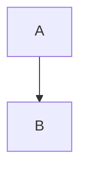
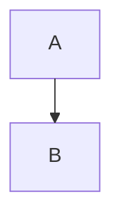
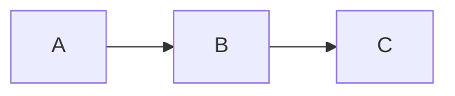
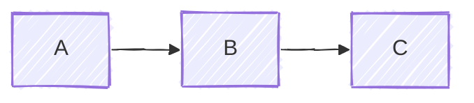
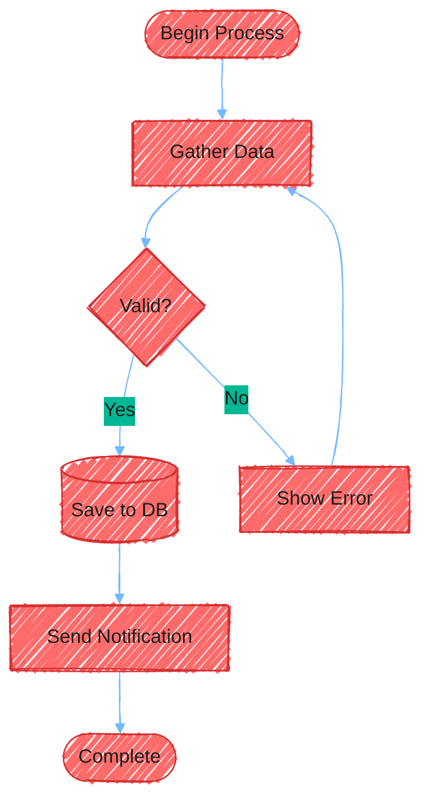
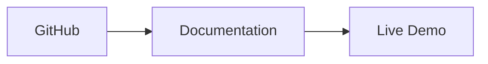
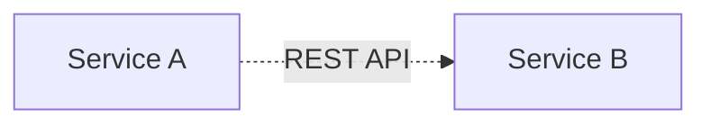
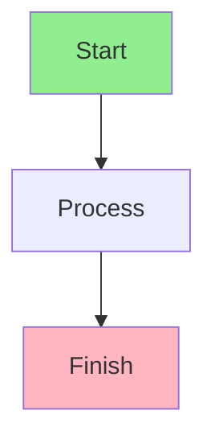
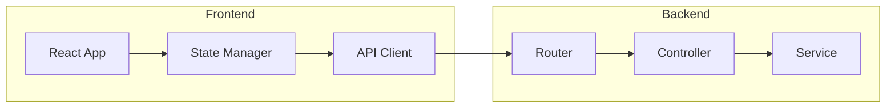
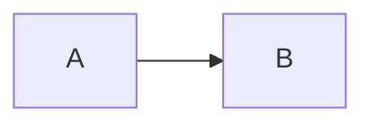

# Advanced Mermaid Features

## Contents

1. [Layout Options](#layout-options)
2. [Look Options](#look-options)
3. [Complete Configuration Example](#complete-configuration-example)
4. [Click Events and Links](#click-events-and-links)
5. [Tooltips](#tooltips)
6. [Comments and Documentation](#comments-and-documentation)
7. [Directional Hints](#directional-hints)
8. [Responsive Sizing](#responsive-sizing)
9. [mermaid-cli Options](#mermaid-cli-options)
10. [Large Diagrams](#large-diagrams)
11. [Integration Examples](#integration-examples)
12. [Best Practices for Advanced Features](#best-practices-for-advanced-features)

Configuration, layout options, and integration patterns. Layout engines, looks, and their options change between Mermaid releases, and each platform pins its own version: verify against the Mermaid docs (mermaid.js.org) before relying on anything here, and render with `mmdc` to confirm.

<example name="Layout: Dagre">

## Layout Options

### Dagre Layout

The classic layout engine:



</example>

<example name="Layout: ELK">

### ELK Layout

For one large diagram whose edges cross badly under dagre:



**ELK node placement strategies:**
- `SIMPLE` - Basic placement
- `NETWORK_SIMPLEX` - Network optimization
- `LINEAR_SEGMENTS` - Linear arrangement
- `BRANDES_KOEPF` - Balanced (default)

A renderer without ELK falls back to dagre or fails, depending on its version.

</example>

<example name="Look: Classic">

## Look Options

### Classic Look

Traditional Mermaid appearance:



</example>

<example name="Look: Hand-Drawn">

### Hand-Drawn Look

Sketch-like, informal style:



</example>

<example name="Complete Configuration">

## Complete Configuration Example



</example>

<example name="Click Events">

## Click Events and Links

Make nodes open a URL:



Clicks work only when the renderer runs with `securityLevel: 'loose'`. Mermaid's default is `strict`, which turns them off, so most hosted renderers show the nodes without links.

</example>

<example name="Tooltips">

## Tooltips

The quoted string after the URL is the hover text, and `_blank` opens the link in a new tab:



The same `securityLevel` limit as click events applies.

</example>

<example name="Comments">

## Comments and Documentation



</example>

<example name="Directional Hints">

## Directional Hints

Override layout direction within subgraphs to mix horizontal and vertical flows:



</example>

## Responsive Sizing

Use CSS to make diagrams responsive:

```html
<div style="max-width: 100%; overflow: auto;">
    <pre class="mermaid">
        flowchart LR
            A --> B --> C
    </pre>
</div>
```

## mermaid-cli Options

SKILL.md Step 3 has the render routine. These flags adjust the output:

```bash
# Transparent background (the default is white)
mmdc -i diagram.mmd -o diagram.svg -b transparent

# Sharper PNG: double the device scale factor
mmdc -i diagram.mmd -o diagram.png -s 2

# Built-in theme without editing the diagram
mmdc -i diagram.mmd -o diagram.svg -t dark

# Render every mermaid block in a Markdown file to images,
# and write a copy of the file that links to them
mmdc -i README.md -o README.rendered.md
```

Size flags differ between mermaid-cli versions (`-w` and `-H` in older releases, `--size` in newer ones). Run `mmdc -h` and use the flags it lists.

## Large Diagrams

SKILL.md Step 2 sets the default: split a diagram of more than about 15 nodes into focused views. When the user wants one large diagram anyway:
- Switch to `layout: elk` and enable `mergeEdges` (see ELK Layout above)
- Group related nodes in subgraphs to reduce visual complexity
- Limit styling to the nodes that need it

<example name="Integration: Markdown">

## Integration Examples

### Markdown Files

````markdown
# System Architecture


````

</example>

<example name="Integration: HTML">

### HTML Files

Load Mermaid from a CDN pinned to a major version (11 in this example), and verify the current major version against the Mermaid docs.

```html
<!DOCTYPE html>
<html>
<head>
    <script type="module">
        import mermaid from 'https://cdn.jsdelivr.net/npm/mermaid@11/dist/mermaid.esm.min.mjs';
        mermaid.initialize({
            startOnLoad: true,
            theme: 'dark',
            look: 'handDrawn'
        });
    </script>
</head>
<body>
    <pre class="mermaid">
        flowchart LR
            A --> B
    </pre>
</body>
</html>
```

</example>

<example name="Integration: React">

### React Components

Pass the diagram as a string, because JSX joins text lines and Mermaid needs the line breaks. `mermaid.render` returns a promise of the SVG markup:

```jsx
import { useEffect, useRef } from 'react';
import mermaid from 'mermaid';

mermaid.initialize({ startOnLoad: false, theme: 'forest' });

let diagramCount = 0;

export function MermaidDiagram({ chart }) {
    const ref = useRef(null);

    useEffect(() => {
        let cancelled = false;
        const id = `mermaid-${++diagramCount}`;
        mermaid.render(id, chart)
            .then(({ svg }) => {
                if (!cancelled && ref.current) ref.current.innerHTML = svg;
            })
            .catch((err) => {
                // Show the parse error instead of an empty box
                if (!cancelled && ref.current) ref.current.textContent = String(err);
            });
        return () => { cancelled = true; };
    }, [chart]);

    return <div ref={ref} />;
}

// Usage:
// <MermaidDiagram chart={`flowchart LR
//     A --> B`} />
```

</example>

## Best Practices for Advanced Features

1. **Switch to ELK when dagre produces crossed lines** in a diagram the user wants kept whole. Add `layout: elk` to the config frontmatter.
2. **Group each distinct phase or bounded context in a subgraph** named after it.
3. **Commit config frontmatter alongside the diagram** so theme changes appear in code review diffs.
