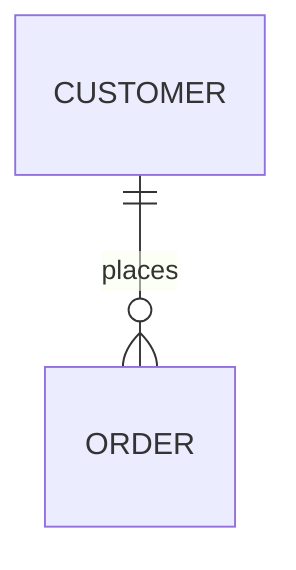
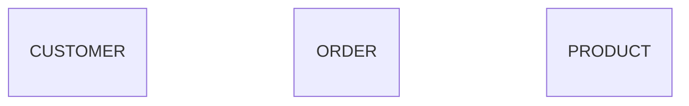
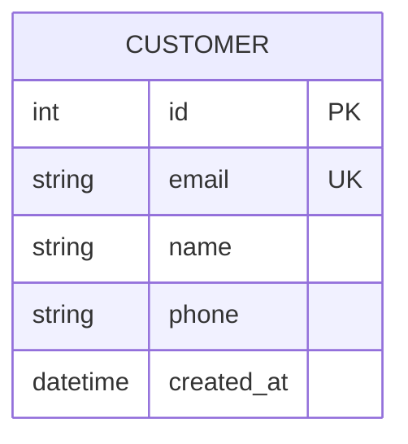
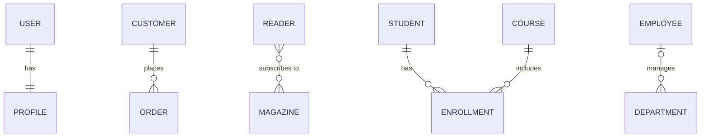
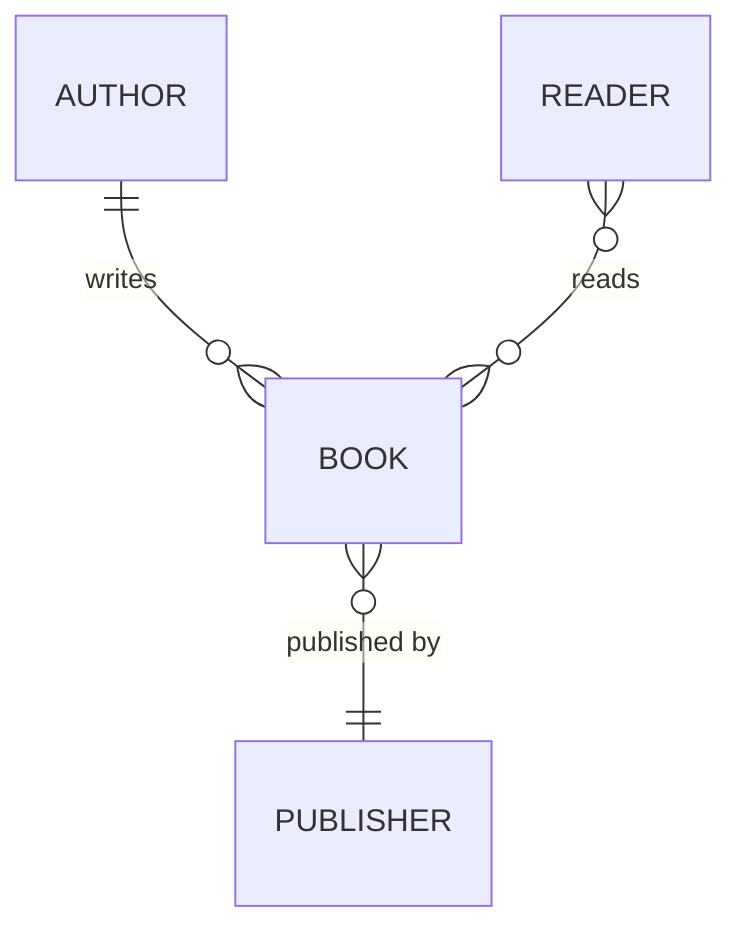
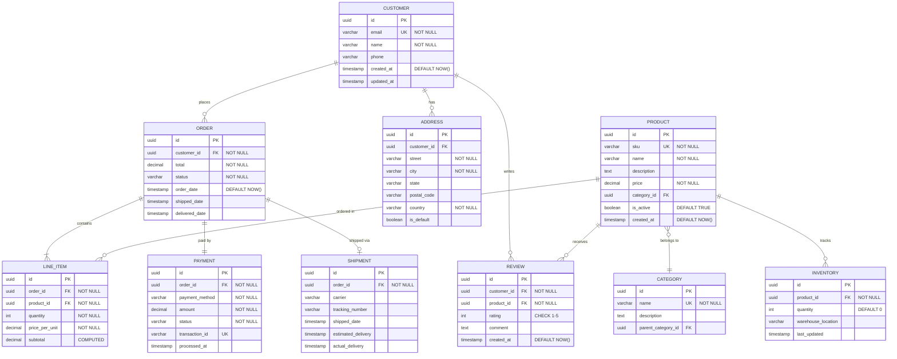

# Entity Relationship Diagrams - Basics

## Contents

1. [Basic Syntax](#basic-syntax)
2. [Defining Entities](#defining-entities)
3. [Entity Attributes](#entity-attributes)
4. [Relationships](#relationships)
5. [Comprehensive Example: E-Commerce Database](#comprehensive-example-e-commerce-database)

<example name="Basic Syntax">

## Basic Syntax

</example>

<example name="Entities">

## Defining Entities

</example>

<example name="Entity Attributes">

## Entity Attributes

Define columns with type and constraints:

**Attribute format:** `type name [keys] ["comment"]`

- **Type:** free text that starts with a letter, so copy it from the user's schema (`varchar(255)` is valid).
- **Keys:** `PK`, `FK`, and `UK`. Combine them with a comma: `PK, FK`.
- **Comment:** a quoted string at the end of the line, such as `"NOT NULL"`. It cannot contain a double quote.

</example>

## Relationships

### Relationship Symbols

**Cardinality** (written on each end; the right end mirrors the left):
- `||` - Exactly one
- `|o` / `o|` - Zero or one
- `}|` / `|{` - One or many
- `}o` / `o{` - Zero or many

**Relationship line:**
- `--` (solid) - The default for every relationship, as in all the examples here.
- `..` (dashed) - Use it only when the user wants identifying and non-identifying relationships told apart. Then `..` marks a non-identifying one (the child has its own key) and `--` an identifying one (the child's key includes the parent's key).

**Label:** every relationship needs one after the colon. Quote a label of more than one word: `: "belongs to"`.

<example name="Common Relationships">

### Common Relationships

</example>

<example name="Relationship Labels">

### Relationship with Labels

</example>

<example name="E-Commerce Database">

## Comprehensive Example: E-Commerce Database

</example>
