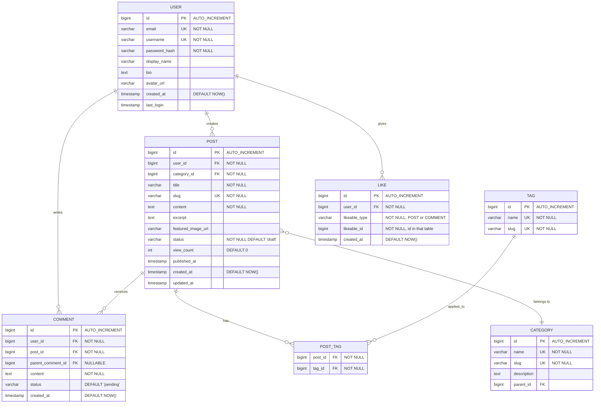
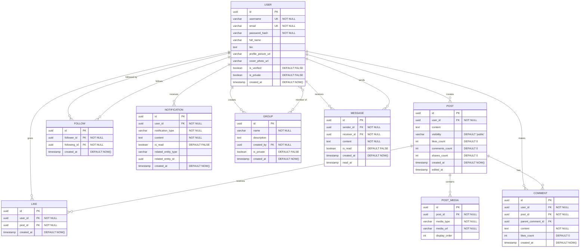
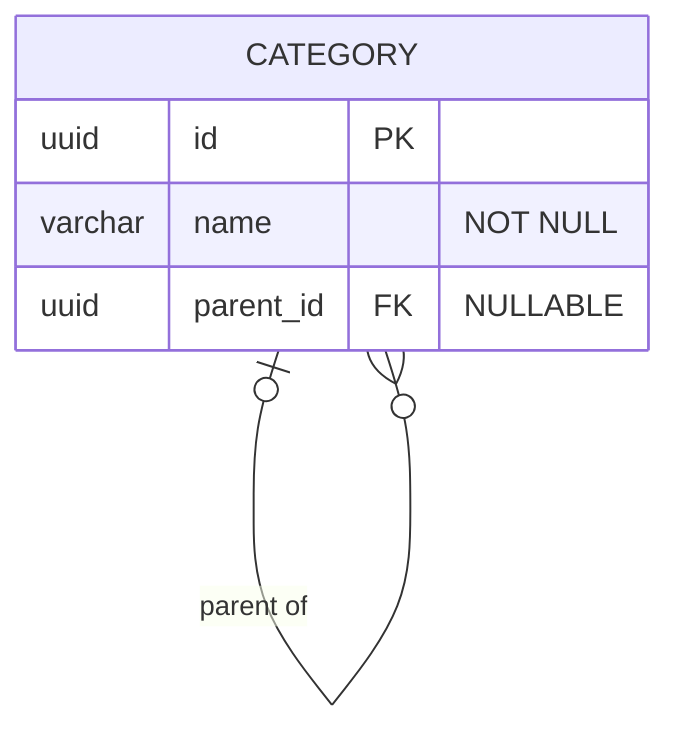
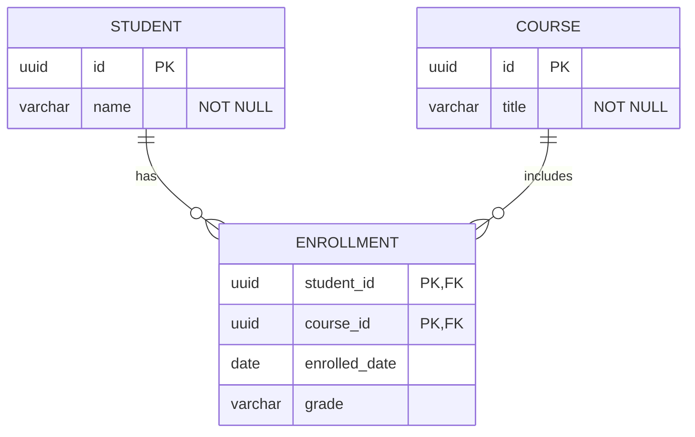
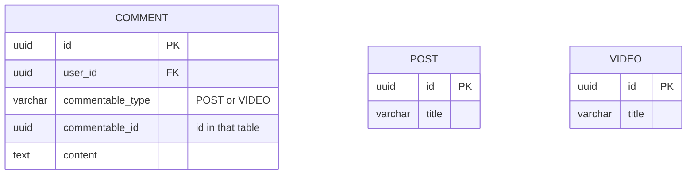
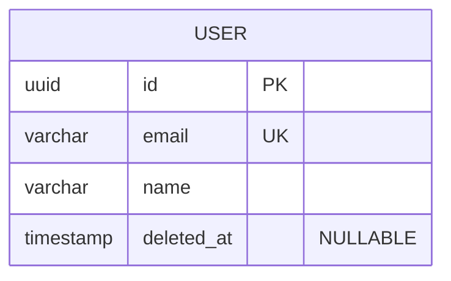
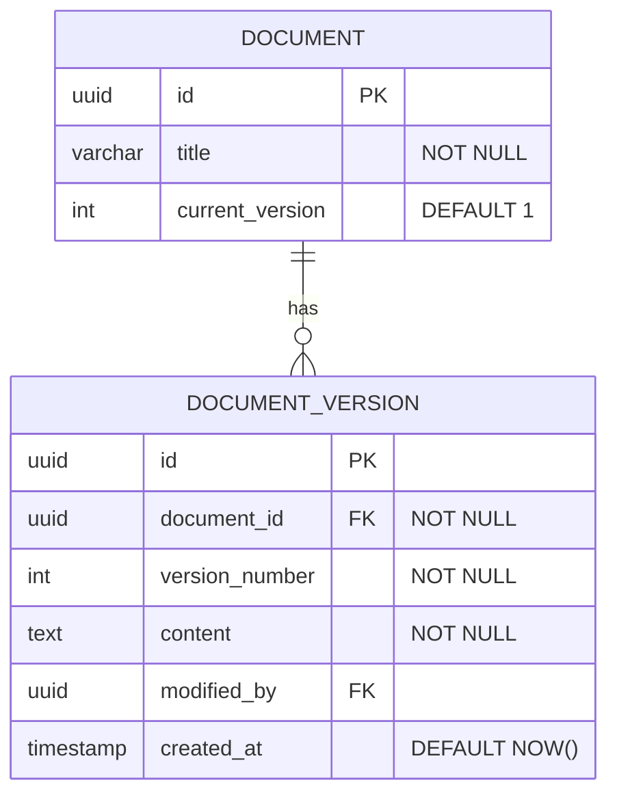

# Entity Relationship Diagrams - Patterns

## Contents

1. [Blog Platform Schema](#blog-platform-schema)
2. [Social Media Schema](#social-media-schema)
3. [Best Practices](#best-practices)
4. [Common Patterns](#common-patterns)

Real-world schema examples, best practices, and common database design patterns.

<example name="Blog Platform">

## Blog Platform Schema

</example>

<example name="Social Media">

## Social Media Schema

</example>

## Best Practices

1. **Name entities in UPPERCASE singular** - `USER` not `USERS`, `ORDER` not `ORDERS`. When drawing an existing schema, keep its table names instead.
2. **Mark every constraint the schema has** - Add `PK`, `FK`, `UK`, and `"NOT NULL"` on every column that has them. Missing constraints are invisible bugs.
3. **Specify exact cardinality** - Use `||--o{` (one-to-many) vs `}o--o{` (many-to-many). Wrong cardinality misleads schema reviews.
4. **Draw only the columns the schema has** - Show `created_at`, `updated_at`, and similar audit columns when they exist; never invent columns to fill out a table.
5. **Use a junction table when the link has its own columns** - Show the join entity with its attributes (e.g., `enrolled_date` on `ENROLLMENT`), and do not also draw a direct many-to-many line between the same two entities. A link with no columns can be a single `}o--o{` line.
6. **Mark computed columns with `"COMPUTED"`** so readers know they are derived, not stored.

## Common Patterns

<example name="Self-Referencing">

### Self-Referencing (Hierarchical)

</example>

<example name="Junction Table">

### Junction Table (Many-to-Many)

</example>

<example name="Polymorphic">

### Polymorphic Relationship

Mermaid cannot draw a foreign key that points at one of several tables. Show the type and id columns, and say in a comment which tables they point at.

</example>

<example name="Soft Deletes">

### Soft Deletes

</example>

<example name="Audit Trail">

### Audit Trail

</example>

