# Other Diagram Types

## Contents

1. [State Diagrams](#state-diagrams)
2. [Git Graphs](#git-graphs)
3. [Gantt Charts](#gantt-charts)
4. [Pie Charts](#pie-charts)
5. [Quadrant Charts](#quadrant-charts)
6. [Best Practices by Diagram Type](#best-practices-by-diagram-type)

State diagrams, git graphs, gantt charts, and pie/quadrant charts for specialized visualization needs.

## State Diagrams

<example name="Basic State">

### Basic Syntax
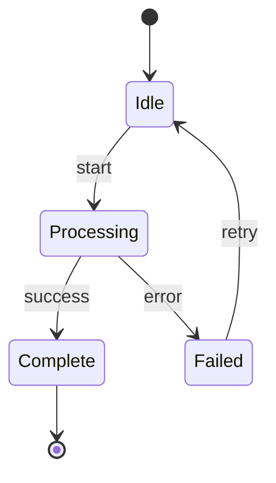

</example>

<example name="Composite States">

### Composite States
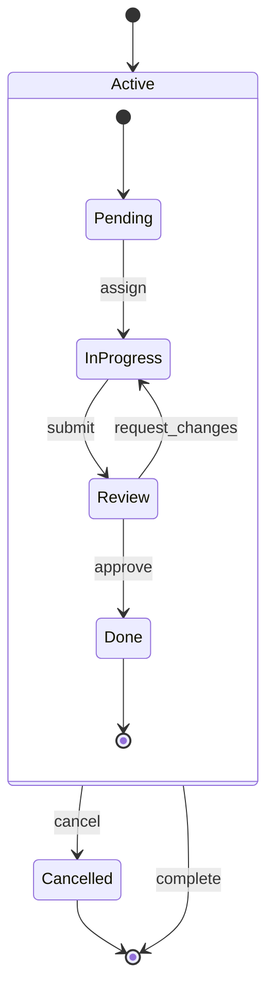

</example>

<example name="Order Lifecycle">

### Order Lifecycle Example
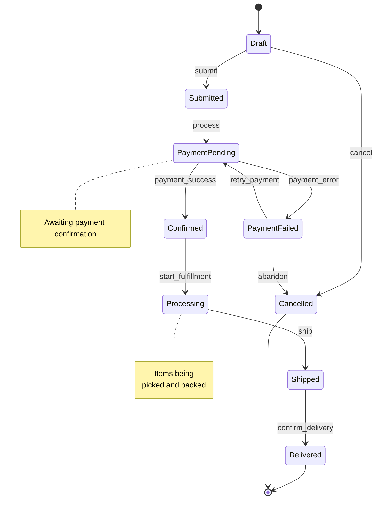

</example>

<example name="Concurrent States">

### Concurrent States (Fork/Join)
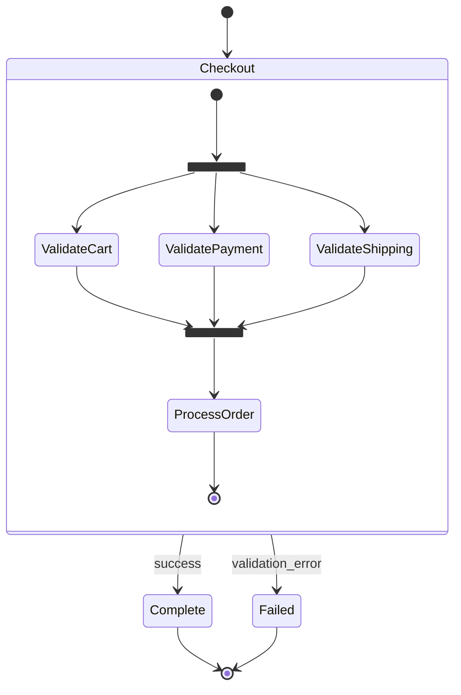

</example>

## Git Graphs

<example name="Basic Git Graph">

### Basic Syntax
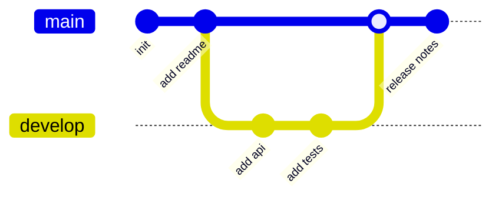

</example>

<example name="Feature Branch">

### Feature Branch Workflow
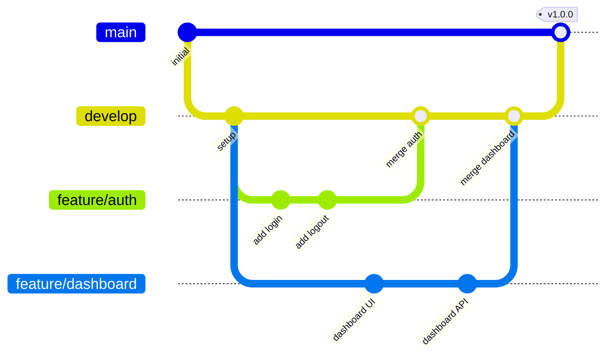

</example>

<example name="GitFlow">

### GitFlow Workflow
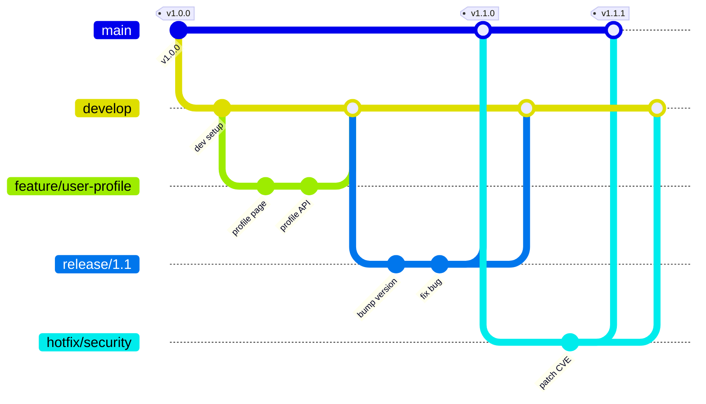

</example>

## Gantt Charts

<example name="Basic Gantt">

### Basic Syntax
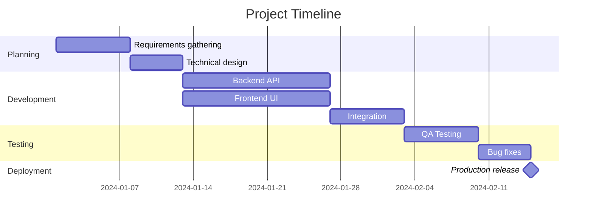

</example>

<example name="Sprint Planning">

### Sprint Planning
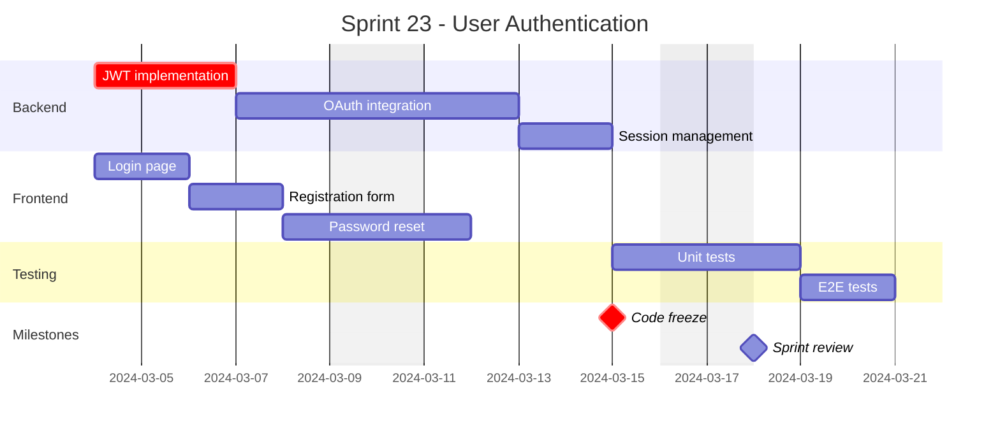

</example>

<example name="Product Roadmap">

### Product Roadmap
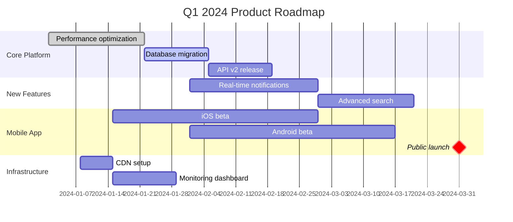

</example>

## Pie Charts

<example name="Basic Pie">

### Basic Syntax
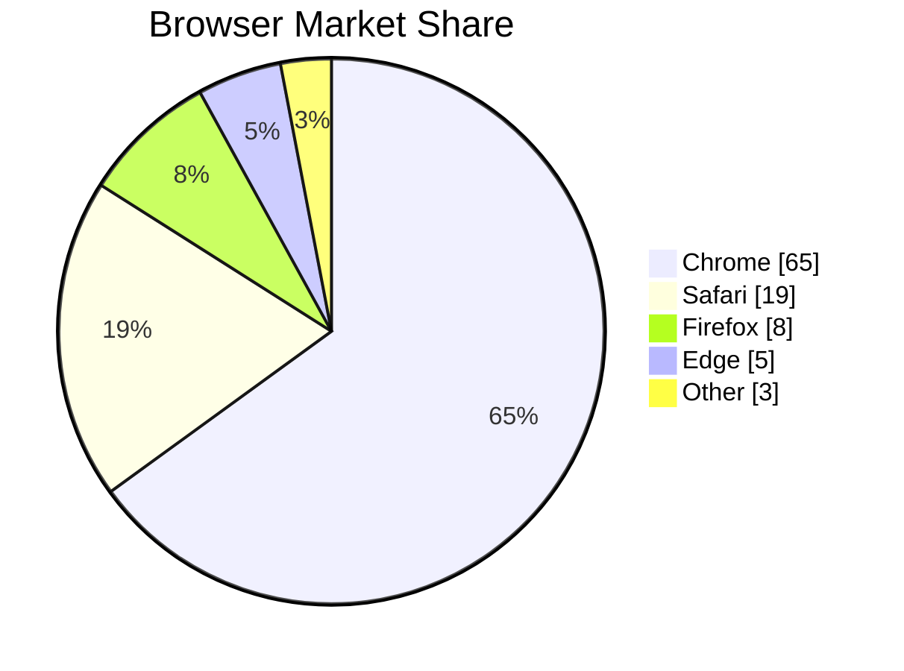

</example>

<example name="Sprint Breakdown">

### Sprint Work Breakdown
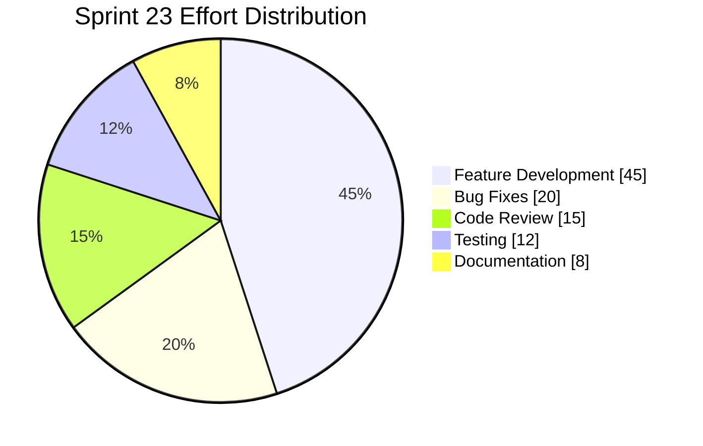

</example>

## Quadrant Charts

The x-axis runs left to right and the y-axis bottom to top. `quadrant-1` is the top right, `quadrant-2` the top left, `quadrant-3` the bottom left, and `quadrant-4` the bottom right. Points are `Name: [x, y]`, with both values from 0 to 1.

<example name="Basic Quadrant">

### Priority Matrix
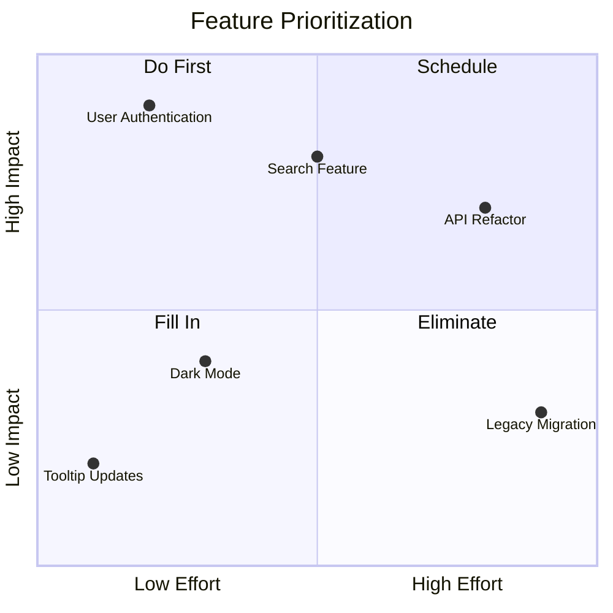

</example>

<example name="Tech Debt">

### Technical Debt Assessment
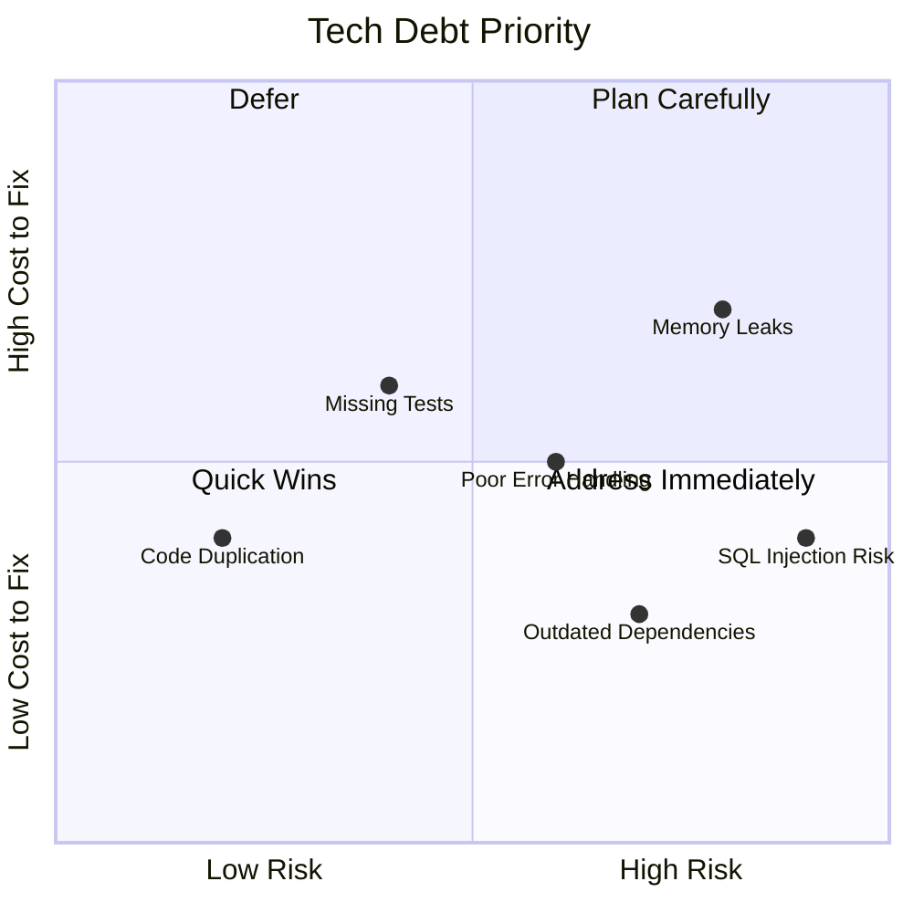

</example>

## Best Practices by Diagram Type

### State Diagrams
- Begin every diagram with `[*] --> InitialState` and end every terminal state with `FinalState --> [*]`.
- Label every transition with the trigger event name (e.g., `: submit`, `: cancel`). `[*]` and fork/join edges need none.
- When several states share an exit (such as `cancel`), wrap them in a `state` composite block named after the phase, so one transition covers them all.
- Add `note right of StateName` to explain non-obvious transition guards.

### Git Graphs
- Set `id:` on every `commit` line to a short descriptive label (e.g., `id: "add auth"`).
- Tag release commits on main with `tag: "v1.0.0"`.
- Name short-lived branches with the `type/name` convention (e.g., `feature/auth`, `hotfix/security`); long-lived ones keep plain names such as `develop`.

### Gantt Charts
- Add `excludes weekends` when durations count working days, as in the Sprint Planning example; leave it out when they count calendar days.
- Mark key dates with `milestone`, and mark the critical path with `crit` when it matters to the reader.
- Group tasks into `section` blocks named after project phases.
- Use `after taskId` for dependencies rather than hardcoded dates where possible.

### Pie/Quadrant Charts
- Cap pie charts at 5-7 segments. Merge small slices into "Other".
- Add `showData` to every pie chart so values are visible.
- Label all four quadrants with actionable names (e.g., "Do First", "Eliminate"), and check each label against its corner: the high-x, high-y corner is `quadrant-1`, top right.
