# Theming and Styling

## Contents

1. [Frontmatter Configuration](#frontmatter-configuration)
2. [Themes](#themes)
3. [Custom Theme Variables](#custom-theme-variables)
4. [Diagram-Specific Styling](#diagram-specific-styling)
5. [Subgraph Styling](#subgraph-styling)
6. [Complex Styling Example](#complex-styling-example)
7. [Accessibility Considerations](#accessibility-considerations)
8. [Best Practices for Theming](#best-practices-for-theming)

Visual customization for Mermaid diagrams including themes, colors, and styling options.

<example name="Frontmatter Configuration">

## Frontmatter Configuration

Add YAML configuration at the top of diagrams:

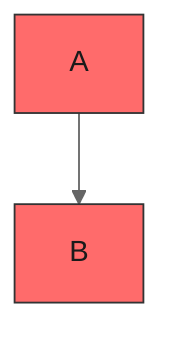

</example>

## Themes

### Built-in Themes

Set `theme:` under `config:` in the frontmatter, as in the examples below. Default to `default`; use `base` when you need custom colors.
- `default` - Standard blue theme
- `forest` - Green earth tones
- `dark` - Dark mode friendly
- `neutral` - Grayscale, good for print
- `base` - Minimal base theme, the only one `themeVariables` can change

Newer Mermaid releases add more themes. Verify the list against the Mermaid theming docs before using a theme not listed here.

<example name="Default Theme">

### Theme Examples

**Default Theme:**
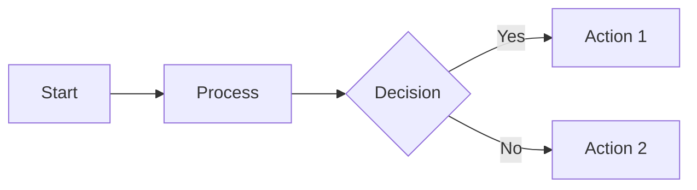

</example>

<example name="Dark Theme">

**Dark Theme:**
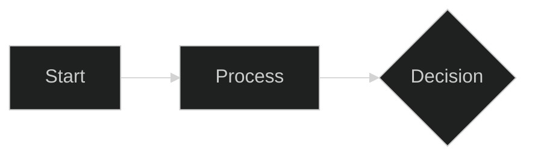

</example>

<example name="Forest Theme">

**Forest Theme:**
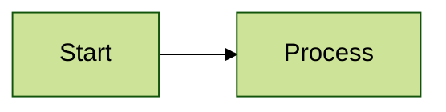

</example>

<example name="Custom Theme Variables">

## Custom Theme Variables

Override specific colors. Two rules decide whether an override shows up: it works only with `theme: base`, and only hex colors are recognized (`#ff6b6b` works, `red` does not).

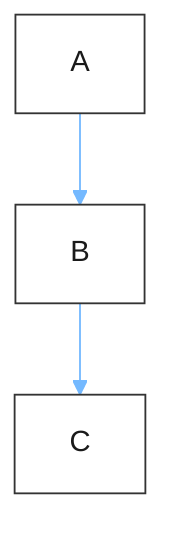

</example>

<example name="Class-based Styling">

## Diagram-Specific Styling

### Flowchart Styling

**Class-based styling:**
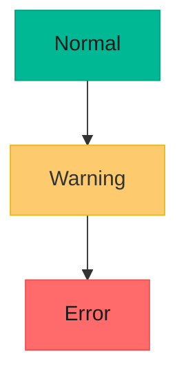

</example>

<example name="Node-specific Styling">

**Node-specific styling:**
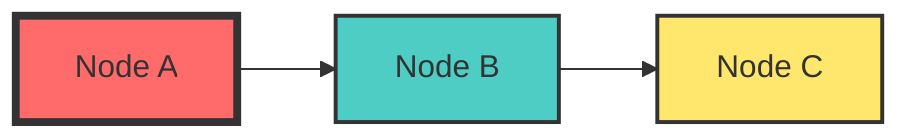

</example>

<example name="Link Styling">

**Link styling:**
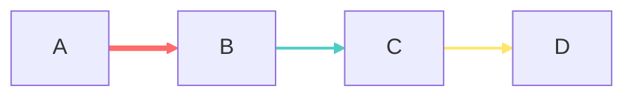

</example>

<example name="Sequence Diagram Styling">

### Sequence Diagram Styling

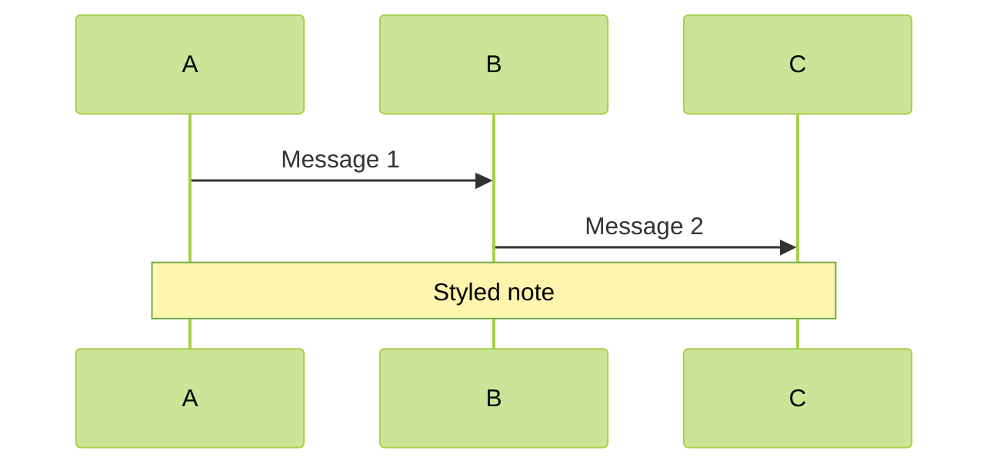

</example>

<example name="Class Diagram Styling">

### Class Diagram Styling

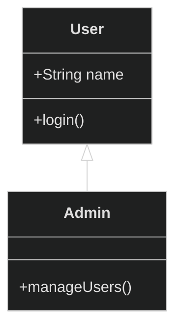

</example>

<example name="Subgraph Styling">

## Subgraph Styling

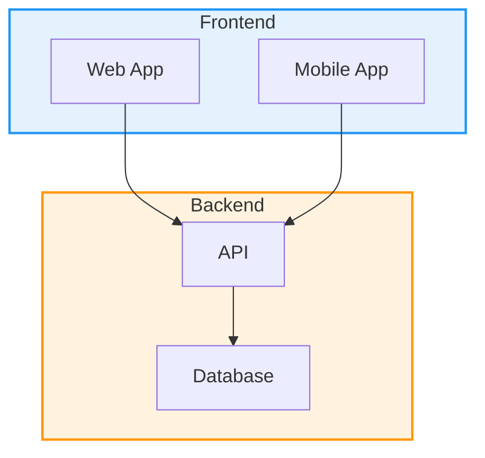

</example>

<example name="Complex Styling">

## Complex Styling Example

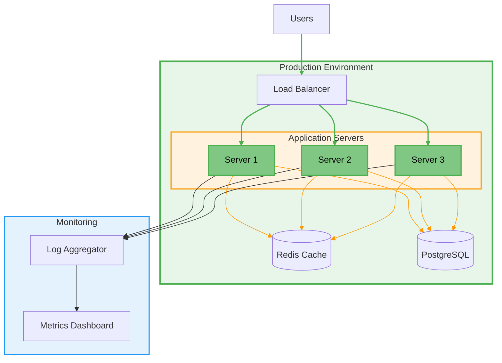

</example>

<example name="Accessible Styling">

## Accessibility Considerations

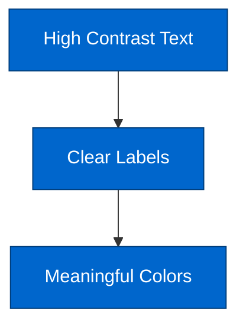

**Accessibility tips:**
- Use high contrast color combinations
- Don't rely solely on color to convey meaning
- Include descriptive text labels
- Test with color blindness simulators
- Provide a dark mode alternative when the target page supports it

</example>

## Best Practices for Theming

1. **Pick one theme per document** - All diagrams in the same page or README should share the same theme for visual consistency.
2. **Limit custom fill colors to 3-4 per diagram** - More than that creates visual noise. Use `classDef` to apply them consistently.
3. **Try `look: handDrawn` for informal docs** and `look: classic` for technical specifications. Match the tone to the audience.
4. **Check text contrast** (the ratio is in SKILL.md's Best Practices) for every `primaryTextColor`/`primaryColor` pair and every `classDef` fill and text color.
5. **Put config frontmatter in the diagram** rather than global CSS so each diagram is self-contained and portable.
